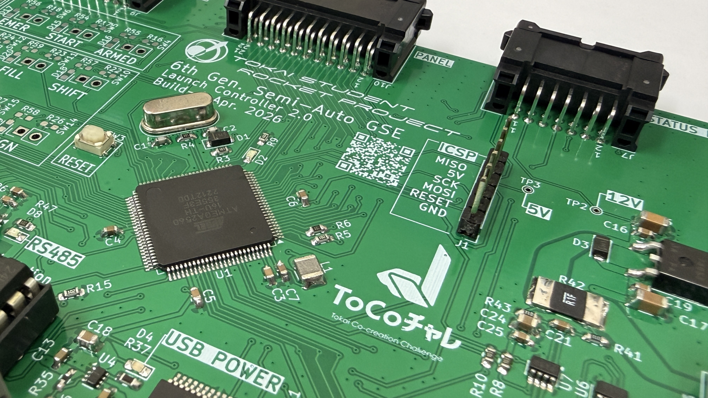

# 第6世代 Ground Support Equipment (GSE)

**2025年3月8日，H-60号機打上げ実験にて運用をし正常に動作したことを確認しました．**

## システムの特徴
- 従来の大型電源をやめてバッテリー駆動にし，小型軽量化しました．フィールドでの運用が楽になります．
- Arduino で記述し，PlatformIO で開発しています．コードは機能ごとにモジュールに分けてあり，外部ライブラリは PlatformIO が自動で管理します．
- VESIM10 圧力センサと ADS1115 ADC で N2O の圧力を高精度にリアルタイム計測し，離れた場所から監視できます．
- セミオートマチックシーケンスと緊急停止 (E-STOP) 機能があり，フェールセーフと安全インターロックを組み込んでいます．

## バージョン履歴
| バージョン | 主な特徴・追加機能 | ソースファイル | PlatformIO 環境名 |
|---|---|---|---|
| Gen6 1.0 | 初代．2025年3月8日 H-60号機打上げ実験で運用．RS485有線通信，セミオートシーケンス | `src/LaunchController/`<br>`src/SatelliteController/` | `[env:Launch]`<br>`[env:Satellite]` |
| Gen6 2.0 | 安全性と安定性を強化．電磁弁故障検出のデバウンス，リミットスイッチによる安全ゲートの監視，ゼロ点校正時の安全判定を追加し，通信アルゴリズムを見直し | `src/LaunchController2.0/`<br>`src/SatelliteController2.0/` | `[env:Launch2]`<br>`[env:Satellite2]` |


## ギャラリー
- [2025年3月8日 H-60号機打上げ実験](https://github.com/tokai-student-rocket-project/Gen6-GSE-Elec/blob/main/Documents/Pictures/Gallery/Gallery.md)

## ドキュメント
- [仕様](./Documents/Manuals/Specification.md)
- [GSE運用マニュアル](./Documents/Manuals/Gen6GSEManual-Elec.md)
- [パーツリスト](./Documents/Development/PartsList.xlsx)
- [自動シークエンスタイミングの考え方](./Documents/Software/AutoSequence.md)
- [通信・タスク管理ライブラリについて](./Documents/Software/library_guide.md)
- [亜酸化窒素の圧力計測について](./Documents/Sensor/VESIM10_Manual.md)
  - [校正シート](./Documents/Sensor/VESIM10_Calibration.xlsx)
  - [試験成績表(TSRP Only)](https://u-tokai.box.com/s/f19nbcfg3vuwrdxsdca0jw9x3lm8z8kp)
- [各種ドキュメント一覧・目次](./Documents/README.md)

## フォルダ構成

```
Gen6-GSE-Elec/
├── Documents/        # 資料保管場所．できる限りの情報を残せるように頑張ります．
├── include/          # 特に使用していません．(PlatformIO自動生成)
├── KiCad/            # サテライトコントローラーとランチコントローラーの基板 (KiCad 10.0)
├── lib/              # ライブラリ．新しく作成する際はここに置くと分かりやすいです．(PlatformIO自動生成)
├── src/              # ランチコントローラーとサテライトコントローラーのソースファイル (PlatformIO自動生成)
├── test/             # test機能を使っていないので意味はありません．(PlatformIO自動生成)
├── LICENSE           # ライセンス
└── platformio.ini    # PlatformIOの設定ファイル
```

- 基板はオープンソースのEDAである[KiCad](https://www.kicad.org/)で作成しました．(開発中に KiCad 8.0 → KiCad 10.0 となりました．)
- ソースはArduinoで記述していますが，[PlatformIO](https://platformio.org/)の仕様上 .ino ファイルではなく .cpp ファイルになっています．
- platformio.ini の中身は[platform.iniについて](#platforminiについて)を参照してください．

## platformio.iniについて

[platformio.ini](./platformio.ini) はPlatformIOを使用するための設定ファイルです．外部ライブラリがインストールされていなくてもこのファイルに記載があれば自動的にインストールしてくるため環境構築を行いやすくなり，とても便利です．参照：[公式](https://docs.platformio.org/en/latest/projectconf/index.html)

platformio.iniファイルにはセクションがあり，それぞれに対してKeyとValueのペアがあります．ここでは安定版である 1.0 と 2.0 の環境だけを説明します．3.0 やデモ用・デバッグ用の環境については platformio.ini 内のコメントを見てください．

> [!NOTE]
> ここの説明を読むより，[公式](https://docs.platformio.org/en/latest/projectconf/index.html)の説明を読んだ方が正確で分かりやすいです！

| 環境名 | バージョン | 対象 | ソースファイル |
|---|---|---|---|
| `Satellite` | 1.0 | サテライトコントローラー | `src/SatelliteController/SatelliteController.cpp` |
| `Launch` | 1.0 | ランチコントローラー | `src/LaunchController/LaunchController.cpp` |
| `Satellite2` | 2.0 | サテライトコントローラー | `src/SatelliteController2.0/SatelliteController2.0.cpp` |
| `Launch2` | 2.0 | ランチコントローラー | `src/LaunchController2.0/LaunchController2.0.cpp` |

ビルドと書き込みは `pio run -e Satellite2 -t upload` のように環境名を指定して行います．

### 共通設定
[env]
> 名前のない `[env]` はすべての環境に共通の設定です．各環境で `lib_deps` を書くとこちらは上書きされるため，2.0 では `${env.lib_deps}` で読み込んでから追加のライブラリを書いています．

lib_deps = hideakitai/TaskManager, hideakitai/MsgPacketizer
> 通信とタスク管理に使うライブラリです．詳しくは[通信・タスク管理ライブラリについて](./Documents/Software/library_guide.md)を参照してください．

### 1.0 サテライトコントローラー
[env:Satellite]
> 環境を示しています．今回はサテライトコントローラーの環境になります．

platform = atmelavr
> 使用するマイコンに合わせています．参照：[公式](https://docs.platformio.org/en/latest/projectconf/sections/env/options/platform/platform.html)

board = ATmega2560
> 使用するマイコンが持つ固有の値を入れています．参照：[公式](https://docs.platformio.org/en/latest/projectconf/sections/env/options/platform/board.html)

framework = arduino
> 使用したいフレームワークを指定しています．参照：[公式](https://docs.platformio.org/en/latest/frameworks/index.html#frameworks)

monitor_speed = 115200
> シリアルモニターのボーレートを指定しています．なお，VScodeの拡張機能である Serial Monitor を使用する場合は拡張機能側で設定する必要があるため関係ありません．

upload_protocol = arduinoisp
> ArduinoISP を使用して書き込むため指定しています．（シリアル変換ICの影響か，USB経由で書き込みができなかったため．つけていて良かった．）

upload_speed = 19200
upload_flags = ...
upload_command = avrdude $UPLOAD_FLAGS -U flash:w:$SOURCE:i
> ArduinoISP 周りの設定です．avrdude を stk500v1 として 19200bps で動かして書き込んでいます．

lib_deps = ...
> 外部ライブラリを指定しています．Adafruit INA219，Mcp320x，TaskManager，CRCx，MsgPack，MsgPacketizer の6つです．

build_src_filter = +<SatelliteController/SatelliteController.cpp>
> env:Satellite の環境に書き込みたいソースファイルを指定できます．

build_flags = ...
> ライブラリの上限値をマクロで変更しています．値は[build_flags の値](#build_flags-の値)にまとめています．

### 1.0 ランチコントローラー
[env:Launch]
> ランチコントローラーの環境です．`platform`，`board`，`framework`，`monitor_speed`，`lib_deps` は[1.0 サテライトコントローラー](#10-サテライトコントローラー)と同じです．

build_src_filter = +<LaunchController/LaunchController.cpp>
> 書き込むソースファイルです．

> [!NOTE]
> サテライトコントローラーと違い `upload_protocol` などの ArduinoISP 関連の設定はないため，通常どおり USB 経由で書き込みます．

### 2.0 サテライトコントローラー
[env:Satellite2]
> `platform`，`board`，`framework`，`monitor_speed` は 1.0 と同じです．ArduinoISP の設定はないので USB 経由で書き込みます．

lib_deps = ${env.lib_deps}, Adafruit INA219, Mcp320x, Adafruit ADS1X15
> 共通ライブラリに加えて，N2O の圧力計測で使う ADS1115 のために Adafruit ADS1X15 を追加しています．

build_src_filter = +<SatelliteController2.0/SatelliteController2.0.cpp>

### 2.0 ランチコントローラー
[env:Launch2]
> `platform`，`board`，`framework`，`monitor_speed` は 1.0 と同じです．

lib_deps = ${env.lib_deps}, Adafruit INA219, Mcp320x

build_src_filter = +<LaunchController2.0/LaunchController2.0.cpp>

> [!WARNING]
> `Launch2_demo` は `Launch2` に `DEMO_MODE` を付けたシーケンス確認用の環境です．現場運用のファームウェアには絶対に使わないでください．

### build_flags の値
MsgPacketizer と TaskManager は内部のキューや配列の大きさが固定なので，subscribe やタスクを増やしたときはここの値も増やす必要があります．

| マクロ | 内容 | Satellite | Launch | Satellite2 | Launch2 |
|---|---|---|---|---|---|
| `PACKETIZER_MAX_CALLBACK_QUEUE_SIZE` | subscribe できる数 | 12 | 12 | 12 | 12 |
| `PACKETIZER_MAX_STREAM_MAP_SIZE` | 登録できるストリーム数 (Serial1 + Serial) | 4 | 4 | - | - |
| `MSGPACK_MAX_ARRAY_SIZE` | 配列の要素数 | - | 12 | - | - |
| `ARX_VECTOR_DEFAULT_SIZE` | メインタスク数の上限 | 20 | 20 | 25 | 25 |
| `TASKMANAGER_MAX_SUBTASKS` | サブタスク数の上限 | 8 | 8 | 8 | 8 |

`-` は指定なし（ライブラリの既定値）です．

### 手順書
- [せいさくちゅう](./)

### データフロー

- [ランチコントローラー](./Documents/Pictures/DataFlowDiagram/LaunchController_DataFlowDiagram.png)

- [サテライトコントローラー](./Documents/Pictures/DataFlowDiagram/SatelliteController_DataFlowDiagram.png)

## License

Copyright (c) 2025 Tokai Student Rocket Project

This project is licensed under the MIT License. See the [LICENSE](https://github.com/tokai-student-rocket-project/Gen6-GSE-Elec/blob/main/LICENSE) file for more details.


